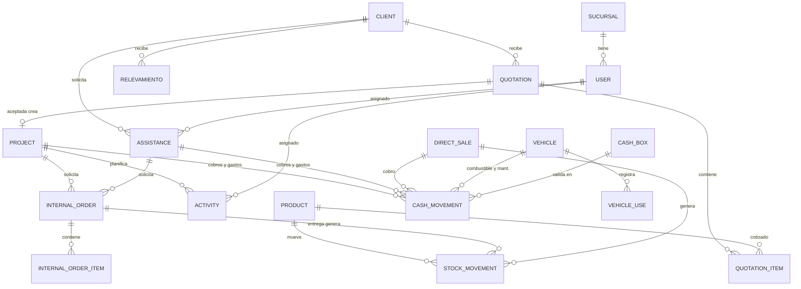

# Diseño de negocio — ERP H&S Tecnologías

Fuente para diseñar el modelo de datos (Fase C) y priorizar módulos. Reemplaza las listas de requisitos anteriores.

## 1. El negocio

- **Qué hace:** instala, certifica y mantiene infraestructura tecnológica para bancos, cooperativas, instituciones y empresas en los 9 departamentos.
- **Divisiones** (se usan para clasificar todo: productos, cotizaciones, proyectos, reportes):
  1. Cómputo y comunicación
  2. Seguridad electrónica
  3. Cableado estructurado (incluye certificación Fluke)
  4. *(Opcional)* Energía: paneles solares, UPS, generadores. Hoy está dentro de Cableado; se separa solo si el dueño lo pide.
- **Sedes:** Central Cochabamba, Sucursal Valle Alto Punata, Sucursal Quillacollo. Habrá más.
- **Proceso comercial:** evaluación en sitio → propuesta técnico-económica → implementación → certificación y soporte.
- **Naturaleza del trabajo:** proyectos de varias semanas con adelantos y saldos adeudados, más compra de material. Una "venta" en sentido estricto es solo un ingreso inmediato.

## 2. Vocabulario (un término por concepto)

| Término | Significado | No usar |
|---|---|---|
| **Cliente** | Empresa o persona atendida | prospecto (es un estado del cliente) |
| **Relevamiento** | Visita presencial para entender la necesidad del cliente | visita, inspección |
| **Cotización** | Propuesta técnico-económica con ítems. Único lugar donde existe el descuento | presupuesto, proforma |
| **Proyecto** | Cotización aceptada: tiene monto oficial, actividades, material, cobros y saldo | venta, trabajo, obra |
| **Actividad** | Tarea programada de un proyecto (instalación, certificación, entrega). Es lo único que aparece en el Cronograma | — |
| **Asistencia** | Servicio técnico pequeño (falla, revisión, soporte). No va al Cronograma; tiene su propia bandeja | soporte, visita técnica |
| **Venta directa** | Venta inmediata de productos del inventario, pagada al momento | venta (sola) |
| **Movimiento** | Registro único de dinero: ingreso, egreso o transferencia | pago, cobro (como tabla) |
| **Cobro** | Movimiento de ingreso de un proyecto, asistencia o venta directa | abono |
| **Gasto** | Movimiento de egreso (material, combustible, viáticos, servicios…) | costo (cuando es salida de dinero) |
| **Costo** | Lo que consumió un proyecto (material del inventario + gastos asignados). Es un cálculo, no un pago | — |
| **Rendición** | Contabilidad valida un movimiento y lo asigna a una caja | conciliación |
| **Caja** | Lugar donde está el dinero validado: caja chica, banco, QR | cuenta |
| **Pedido interno** | Solicitud de material del inventario para un proyecto o asistencia | requerimiento |
| **Producto** | Ítem del catálogo (equipo, material o servicio) | artículo |

## 3. Actores y permisos (modelo abierto)

El equipo trabaja de forma dinámica: **todos ven todo y editan casi todo**. La protección no depende de bloquear pantallas sino del **historial de cambios**: cada edición registra quién, cuándo, qué campo y el valor anterior, y es visible en cada registro.

| Perfil | Rol guardado | Pantalla principal |
|---|---|---|
| Dueño / Gerencia | ADMINISTRADOR | Dashboard general |
| Contabilidad | CONTABILIDAD (existe desde AUTH-01, 2026-10-25: lee todo; valida, edita y anula dinero; ajusta stock) | Bandeja de rendición, cuentas por cobrar |
| Comercial | VENTAS | Cotizaciones y proyectos |
| Técnico | SEGURIDAD ELECTRÓNICA (renombrable a TÉCNICO) | Mis actividades y asistencias |

**Acciones restringidas** (lo único que se controla por perfil):

| Acción | Quién |
|---|---|
| Validar u observar movimientos, gestionar cajas | Contabilidad, Gerencia |
| Cambiar el monto oficial de un proyecto o anular un proyecto | Gerencia |
| Aplicar descuento en una cotización | Comercial, Gerencia |
| Ajustes de inventario | Gerencia, Contabilidad |
| Usuarios y roles | Gerencia |
| Borrar cualquier registro | Nadie: se anula con un motivo |

## 4. Flujos

### 4.1 Proyecto (flujo principal)

```
Contacto (web, WhatsApp/WhatChimp, referido)
  → Cliente
  → Relevamiento (opcional, presencial)
  → Cotización (ítems del catálogo + mano de obra; descuento opcional; PDF)
      estados: borrador → enviada → aceptada | rechazada | vencida
  → Proyecto (al aceptar; monto oficial = total de la cotización, inmutable)
      estados: planificado → en_ejecucion → entregado → cerrado | anulado
      ├─ Actividades → Cronograma (técnicos asignados, fechas)
      ├─ Pedidos internos → salida de inventario → costo del proyecto
      ├─ Gastos del proyecto (combustible, viáticos, material comprado) → costo
      └─ Cobros (adelanto, avance, saldo) → Rendición → Caja
  → Cierre: saldo = 0 y entregado → cerrado; empieza la garantía
```

En cada proyecto: **% cobrado**, **saldo adeudado**, **costo acumulado** y **margen = monto oficial − costo**.

### 4.2 Asistencia (bandeja propia, no va al Cronograma)

`nueva → asignada → en_atencion → resuelta | cancelada`, con prioridad (baja, normal, urgente) y la fecha comprometida.
- Puede cobrarse: se registra un cobro ligado a la asistencia.
- Puede consumir material: pedido interno ligado a la asistencia.
- Si revela una necesidad mayor, se genera un relevamiento o una cotización.
- La bandeja ordena por urgencia y antigüedad, y marca en rojo las vencidas. Es la respuesta al "están saturados".

### 4.3 Venta directa

Productos del inventario → cobro inmediato → salida de stock. No crea proyecto ni actividades. Una cotización que solo tiene productos puede convertirse en venta directa.

### 4.4 Dinero (un solo libro de movimientos)

Todo peso que entra o sale es un **Movimiento**:
- Se crea `por_validar`.
- Contabilidad lo pasa a `validado` (asignando caja) o a `observado` (con motivo; se corrige y vuelve a la bandeja).
- Un movimiento validado lo corrigen Contabilidad o Gerencia **editándolo**: cada cambio queda en su historial (quién, cuándo, campo, valor anterior). También se puede anular con motivo y sale de su caja. (Decisión del dueño, 2026-10-24: el contraasiento "revertir" no se entendía.)
- Cada cobro dice **quién recibió el dinero** (un técnico puede cobrar en sitio): hasta que se valida, ese dinero está "por rendir" a su nombre.

| Tipo | Conceptos | Se liga a |
|---|---|---|
| ingreso | adelanto, cobro, venta directa, asistencia, otro | proyecto, asistencia o venta directa |
| egreso | material, combustible, mantenimiento vehicular, viáticos, servicios, sueldos, alquiler, impuestos, marketing, otro | proyecto, asistencia, vehículo o ninguno (gasto operativo) |
| transferencia | depósito o retiro entre cajas | caja origen → caja destino |

- **Pagado por** (solo en egresos): `empresa` o `empleado`. Si lo pagó el empleado, queda pendiente de reembolso hasta que se marca `reembolsado`.
- **Comprobante:** foto opcional (factura o recibo).
- Las pantallas del dueño son **vistas del mismo libro**, no tablas nuevas:

| Lo que pidió el dueño | Es esta vista del libro |
|---|---|
| Gastos operativos | Egresos sin proyecto |
| Costos operativos | Costo por proyecto, por vehículo y gastos generales del mes |
| Finanzas y contabilidad | Cajas y saldos, bandeja de rendición, cuentas por cobrar, flujo de caja, resultado del mes |
| Control vehicular (dinero) | Egresos con vehículo |

### 4.5 Inventario

- **Producto:** código, nombre, marca, división, categoría, unidad, costo, precio de venta, stock mínimo, tipo (equipo, material o servicio).
- **Stock por sede**, calculado desde los movimientos de inventario. No se guarda un número editable a mano.
- **Movimientos de inventario:**
  - `entrada_compra`: se registra junto con el egreso de la compra, en una sola acción.
  - `salida_proyecto` / `salida_asistencia`: al entregar un pedido interno; suma al costo.
  - `salida_venta_directa`.
  - `transferencia_sede`.
  - `ajuste`: con motivo; lo hacen Gerencia o Contabilidad.
- **Alerta** de stock bajo en el dashboard.

### 4.6 Control vehicular

- **Vehículo:** placa, modelo, sede, responsable, kilometraje.
- **Uso:** técnico, actividad o asistencia, km inicial y final.
- **Combustible y mantenimiento:** son egresos con vehículo (más litros y km para el combustible). Así el rendimiento (km/litro) y el gasto por técnico salen del mismo libro.
- **Alertas** de mantenimiento por kilometraje o fecha.

## 5. Módulos y prioridad

Prioridad 1 es lo que pidió el dueño primero: el área comercial junto con la contable.

| Prioridad | Módulo | Contenido |
|---|---|---|
| **1** | Clientes | Ficha, historial completo, saldo adeudado total |
| **1** | Cotizaciones | Catálogo, plantillas, descuento, PDF, estados, revisión de Contabilidad |
| **1** | Proyectos | Monto oficial, % cobrado, saldo, costo, margen, estado |
| **1** | Finanzas | Movimientos, rendición, cajas, cuentas por cobrar, gastos operativos |
| **1** | Dashboard | Ver §6 |
| 2 | Cronograma | Solo actividades de proyecto |
| 2 | Asistencias | Bandeja con prioridad y vencimiento |
| 2 | Relevamientos | Visita presencial con fotos, ligada a cliente y cotización |
| 2 | Inventario | Productos, stock por sede, movimientos |
| 2 | Pedidos internos | Solicitud → aprobación → entrega (salida de inventario) |
| 2 | Ventas directas | Venta rápida desde inventario |
| 3 | Control vehicular | Vehículos, uso, combustible, mantenimiento |
| 3 | Reportes | Ventas por vendedor y división, cobranza, costos, márgenes, rendimiento vehicular |
| 3 | Contabilidad | Resultado mensual, flujo de caja, exportación a Excel para el contador |
| 4 | Marketing | Leads y campañas, integración con WhatChimp |
| 4 | Automatización | Cotización asistida, servidor MCP, notificaciones |

## 6. Inicio y navegación

La pantalla de inicio sigue este orden, de lo más urgente a lo menos:

1. **Acciones rápidas** (botones grandes): Nueva cotización · Registrar cobro · Registrar gasto · Nueva asistencia · Nuevo relevamiento.
2. **Requiere atención:**
   - Asistencias vencidas o urgentes.
   - Movimientos por validar (Contabilidad).
   - Proyectos con saldo adeudado y sin cobro en 30 días.
   - Cotizaciones enviadas sin respuesta en 7 días.
   - Stock bajo.
   - Reembolsos pendientes.
3. **Actividad reciente:** lo último creado o cambiado por cualquiera, en tiempo real.
4. **Hoy y esta semana:** actividades del cronograma y asistencias asignadas.
5. **Indicadores del mes:** cotizado, aceptado, cobrado, por cobrar, gastos, margen. Gerencia ve todos.

Cada perfil ve primero lo suyo; un técnico, por ejemplo, empieza en "Mis actividades y asistencias". El menú se ordena por frecuencia de uso: Inicio, Proyectos, Cotizaciones, Finanzas, Cronograma, Asistencias, Clientes, Inventario, Pedidos, Relevamientos, Vehículos, Reportes, Marketing, Configuración.

## 7. Automatización e integraciones

| Qué | Cómo | Prioridad |
|---|---|---|
| Generar cotizaciones | Plantillas por tipo de trabajo (ej. "Cableado N puntos Cat6A", "Kit N cámaras IP") con ítems y mano de obra parametrizados. Se llena la cantidad y sale el borrador con precios del catálogo y el PDF con marca H&S | 1 |
| Cotización asistida por IA | Desde las notas del relevamiento, un modelo propone un borrador de ítems del catálogo y la persona lo revisa. Usa la API de Claude u otra | 4 |
| WhatChimp | Un webhook entrante de WhatChimp crea un contacto o lead en el ERP. Desde el ERP, su API REST (`/api/v1/whatsapp`) envía plantillas: cotización enviada, recordatorio de saldo, asistencia programada. El token va como variable de entorno | 4 |
| Servidor MCP | Módulo pequeño que expone herramientas del ERP (buscar clientes, ver proyectos y saldos, crear borrador de cotización, crear asistencia) para usarlas desde Claude u otros agentes. Usa el SDK MCP oficial, que es gratuito | 4 |
| Exportación contable | Libro de movimientos y resultado mensual a Excel o CSV para la contadora | 3 |
| Formulario web | El formulario "Cotizar" de hstecnologias.com envía un webhook al ERP, que crea el lead | 4 |

## 8. Modelo de datos (resumen)



| Área | Entidades |
|---|---|
| Base | Sucursal, User, Session, AuditLog (quién, qué entidad, campo, antes, después, cuándo), Attachment (archivos de cualquier entidad) |
| Comercial | Client, Lead (opcional, prioridad 4), Relevamiento, Quotation, QuotationItem, QuotationTemplate, Division, ProductCategory |
| Proyectos | Project, Activity, Assistance, Task (seguimiento) |
| Inventario | Product, StockMovement, InternalOrder, InternalOrderItem, DirectSale, DirectSaleItem |
| Finanzas | CashMovement, CashBox |
| Vehículos | Vehicle, VehicleUse |
| Metas | SellerGoal |

Reglas del modelo:
- Dinero en `Decimal(12,2)`.
- Estados como texto validado en la API.
- Toda relación con llave foránea real.
- Nada que se pueda calcular se guarda: saldo, % cobrado, stock y costo se calculan desde los movimientos.
- No se borra nada: se anula con motivo.

Se eliminan: Sale, SaleJob, SalePayment, SchedulePayment, Schedule (lo reemplazan Project y Activity). Task se mantiene solo como **seguimiento comercial** (llamar, enviar PDF) ligado a cotización o proyecto.

## 9. Fases de construcción

| Fase | Entrega | Hecho cuando |
|---|---|---|
| P1-a | Base: modelo nuevo, seed, auditoría, permisos abiertos, tiempo real | `pnpm check` pasa y el seed cubre todos los estados |
| P1-b | Clientes + Cotizaciones (catálogo, plantillas, PDF) | Comercial crea una cotización desde plantilla en menos de 2 minutos |
| P1-c | Proyectos + Finanzas (movimientos, rendición, cajas, cuentas por cobrar) | Contabilidad valida cobros y gastos; el proyecto muestra % cobrado, saldo y margen en vivo |
| P1-d | Dashboard | Inicio con acciones, "requiere atención" y actividad reciente |
| P2 | Cronograma, Asistencias, Relevamientos, Inventario, Pedidos, Ventas directas | El material sale del inventario hacia un proyecto y aparece en su costo |
| P3 | Vehículos, Reportes, Contabilidad (exportación) | Rendimiento por vehículo y resultado mensual exportable |
| P4 | Marketing, WhatChimp, MCP, IA | Un lead de WhatsApp llega al ERP y se le envía la cotización por plantilla |

## 10. Decisiones pendientes del dueño

1. ¿El rol técnico se renombra a "TÉCNICO" (abarca las 4 divisiones)?
si se llama Tecnico y abarca las 4 divisiones 
2. Plantillas de cotización iniciales: ¿cuáles son los 5 trabajos más frecuentes?
no se tiene definido, pero se puede hacer un listado de los trabajos más frecuentes y crear plantillas para ellos , es algo que se puede revisar en un futuro
3. ¿Precios con o sin factura? Si se facturan, ¿se maneja IVA en la cotización?
los precios ya son calculados por los encargados de ventas de momento no se implementara esto
4. ¿Las cotizaciones vencen? (sugerido: validez de 15 días)
Si , las cotizaciones vencen y se puede establecer un tiempo de validez de 15 días
5. Cajas iniciales: ¿cuántas y cuáles por sede?
solo hay una caja central en Cochabamba y una caja chica en cada sede, pero esto se puede revisar en un futuro
6. ¿Una asistencia puede convertirse en proyecto, o siempre pasa por cotización?
las asistencias son un servicio adicional que se puede cobrar y no necesariamente pasa por cotización, pero si se detecta una necesidad mayor se puede generar un relevamiento o una cotización